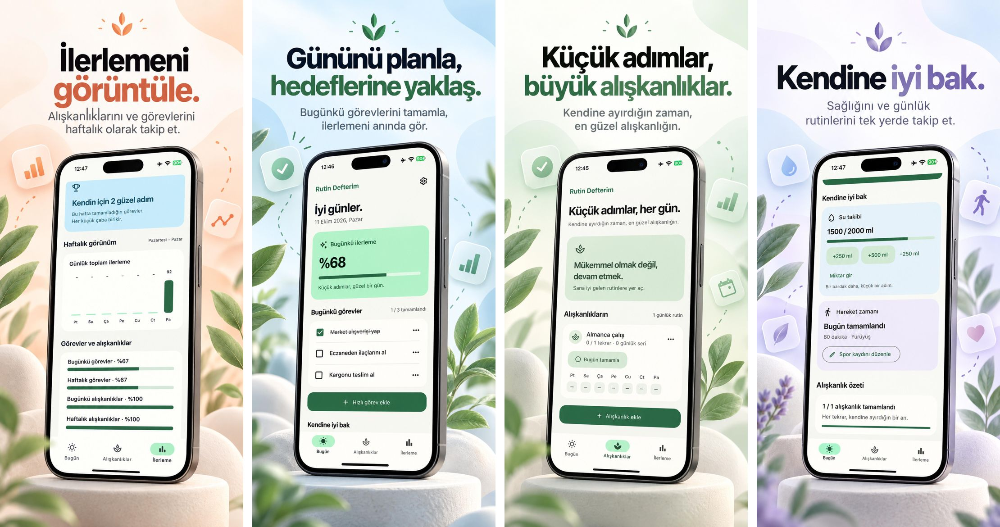

# Rutin Defterim 🌿


**App Store:** https://apps.apple.com/app/rutin-defterim/id6821684589

[English](#english) · [Deutsch](#deutsch) · [Türkçe](#türkçe)



---

## English

Rutin Defterim ("My Routine Notebook") is an offline daily planner and habit tracker for iOS and Android, built with Flutter. It is published on the App Store. The app's interface is in Turkish.

### Features

- Daily tasks with category, time and notes
- Habit tracking with streaks and a weekly overview
- Water and exercise tracking
- Daily and weekly progress charts
- Local reminders (water, tasks, habits)
- Light and dark theme
- Works fully offline: all records stay on the device, no account needed

### Built with

Flutter · Dart · Material 3 · local JSON storage · local notifications · Google Mobile Ads (optional support ad)

---

## Deutsch

Rutin Defterim („Mein Routine-Heft“) ist ein Offline-Tagesplaner und Gewohnheitstracker für iOS und Android, entwickelt mit Flutter. Die App ist im App Store veröffentlicht. Die Oberfläche der App ist auf Türkisch.

### Funktionen

- Tägliche Aufgaben mit Kategorie, Uhrzeit und Notizen
- Gewohnheiten mit Serien und Wochenübersicht
- Wasser- und Sport-Tracking
- Tages- und Wochenfortschritt als Diagramm
- Lokale Erinnerungen (Wasser, Aufgaben, Gewohnheiten)
- Helles und dunkles Design
- Funktioniert komplett offline: alle Daten bleiben auf dem Gerät, kein Konto nötig

### Technologien

Flutter · Dart · Material 3 · lokale JSON-Speicherung · lokale Benachrichtigungen · Google Mobile Ads (optionale Unterstützer-Werbung)

---

## Türkçe

Rutin Defterim, iOS ve Android için Flutter ile geliştirilmiş, çevrimdışı çalışan bir günlük planlama ve alışkanlık takibi uygulamasıdır. App Store'da yayındadır. Uygulamanın eski adı Dayli'dir; bu yüzden kodda bazı dosya ve sınıf adları hâlâ `dayli` olarak geçer.

### Özellikler

- Kategori, saat ve not içeren günlük görevler
- Seri ve haftalık görünümle alışkanlık takibi
- Su ve spor takibi
- Günlük ve haftalık ilerleme grafikleri
- Yerel hatırlatmalar (su, görev, alışkanlık)
- Açık ve koyu tema
- Tamamen çevrimdışı: kayıtlar cihazda kalır, hesap gerekmez

### Kullanılan teknolojiler

Flutter · Dart · Material 3 · yerel JSON kayıt · yerel bildirimler · Google Mobile Ads (isteğe bağlı destek reklamı)

---

# Teknik notlar (Türkçe)

Flutter **3.47.4 stable**, Dart **3.13.3**. Android application ID: **com.acelya.dayli** · iOS bundle identifier: **com.acelya.rutindefteri**.

## Çalıştırma

Flutter SDK kurulu olmalıdır.

```sh
flutter pub get
flutter devices
flutter run -d emulator-5554
```

Emülatör kapalıysa Android Studio Device Manager üzerinden açın veya `flutter emulators` ile kimliğini bulup `flutter emulators --launch EMULATOR_ID` çalıştırın. Genel çalıştırma: `flutter run`. iOS için macOS ve tam Xcode kurulumu gerekir; `ios/Runner.xcworkspace` üzerinden ekip ve imzalama seçilir.

## Dosyalar ve kolay düzenleme

Mimari; tek veri yöneticisi, tek dosya saklama sınıfı ve tek bildirim yöneticisinden oluşur. Ek state management, repository, use case veya grafik katmanı yoktur.

| Dosya / klasör | Ne işe yarar, nereden değiştirilir? |
| --- | --- |
| `lib/main.dart` | Uygulama başlangıcı. |
| `lib/app/dayli_app.dart` | Yerel veriyi açma, yükleme/hata ekranı, tema, gün değişimi ve uygulamaya dönüş. |
| `lib/app/dayli_shell.dart` | Üç sekmeli alt navigasyon ve ikonları. |
| `lib/app/dayli_scope.dart` | Veriyi ekranlarla paylaşan küçük ortak yapı. |
| `lib/core/theme/dayli_theme.dart` | Ana renk, açık/koyu yüzeyler, yazı boyutları, kart yuvarlaklığı, butonlar. |
| `lib/core/widgets/page_layout.dart` | Ortak başlıklar, sayfa boşlukları, maksimum içerik genişliği. |
| `lib/core/widgets/form_helpers.dart` | Klavyeye uyumlu formlar, silme onayı, hata mesajı, boş durum kartı. |
| `lib/core/utils/dayli_date.dart` | Türkçe gün/tarih gösterimi. |
| `lib/features/today/today_screen.dart` | Ana ekran metinleri, saate göre karşılama, ilerleme kartı ve görev listesi. |
| `lib/features/today/task_editor.dart` | Görev ekleme/düzenleme formu, başlık/kategori/saat/not. |
| `lib/features/today/water_card.dart` | Su kartı, mavi tonlar, hızlı miktarlar, manuel ekleme/azaltma. |
| `lib/features/today/sport_card.dart` | Spor kartı, lila tonlar, süre ve spor türleri. |
| `lib/features/habits/habits_screen.dart` | Alışkanlık kartları, tamamlama ve hafta göstergeleri. |
| `lib/features/habits/habit_editor.dart` | Alışkanlık formu, ikon ve renk seçenekleri. |
| `lib/features/progress/progress_screen.dart` | Haftalık grafik, istatistik kartları ve açıklamaları. |
| `lib/features/settings/settings_screen.dart` | Tema seçimi, su hedefi, bildirim tercihleri ve hakkında metni. |
| `lib/data/models.dart` | Görev, alışkanlık, gün kaydı ve ayar modelleri; alan sınırları. |
| `lib/data/dayli_store.dart` | Görev/su/spor/alışkanlık işlemleri, seri ve ilerleme hesapları, gün değişimi. |
| `lib/data/local_storage.dart` | JSON okuma, atomik yazma, son sağlam kopya ve kurtarma. |
| `lib/core/notifications.dart` | İzinler, bildirim metinleri, saatler, planlama ve bildirimden sekme açma. |
| `test/` | Arayüz, veri saklama, tarih/seri, bildirim planı testleri. |

Metinler ilgili ekran dosyalarında doğrudan Türkçe yazılıdır. Ana renkleri tema dosyasından, su/spor kartlarının pastel renklerini kendi kart dosyalarından değiştirebilirsiniz. Alışkanlık renkleri ve ikonları `habit_editor.dart` içindedir. Varsayılan su hedefi ve bildirim ayarları `models.dart` içindeki `DayliSettings` sınıfındadır.

## Yerel kayıt ve gün değişimi

`path_provider` ile uygulamanın özel destek klasörü bulunur. Bu klasörün `dayli/` altına sürümlü `dayli.json` yazılır. Önce geçici dosya diske yazılıp tamamlanır, sonra asıl dosyanın yerine taşınır. Önceki sağlam sürüm `dayli.backup.json` içinde tutulur. İşlemler sırayla kaydedilir; yazma başarısızsa değişiklik geri alınır ve kullanıcıya hata gösterilir. Asıl dosya okunamazsa yedek denenir; ikisi de okunamazsa dosyalar silinmez ve açılışta tekrar deneme sunulur. Bu kopya aynı cihazdadır; cihaz kaybına karşı yedek değildir.

Her gün cihazın yerel takvim tarihine (`YYYY-MM-DD`) göre saklanır. Gün değişimi uygulama açıkken en geç 20 saniyede, uygulamaya dönüldüğünde ve her kayıt işleminde kontrol edilir. Yeni güne boş görev listesi, sıfır su, boş spor ve tamamlanmamış alışkanlıklarla başlanır. Kaçırılan günler sıfır ilerlemeyle oluşturulur. Eski görevler otomatik olarak yeni güne taşınmaz. Önceki kayıtlar korunur. Su ve alışkanlık hedefleri gün bazında saklanır; hedef değişikliği geçmişi değiştirmez. Alışkanlık silmek geçmiş günleri silmez.

Android bulut yedekleme ve cihaz aktarımı kapalıdır. iOS kişisel veri klasörü sistem yedeklemesinden hariç tutulur. Kayıtlar cihazın uygulama korumalı alanındadır; ayrıca uygulama seviyesinde şifreleme yoktur. Kişisel planlama kayıtları sunucuya gönderilmez. Ayarlar’daki isteğe bağlı AdMob reklamları ve izin hizmetleri internet üzerinden cihaz ve reklam etkileşimi verilerini işleyebilir. Uygulamayı kaldırmak kayıtları siler. Dışa aktarma ve cihazlar arası eşitleme bu sürümde yoktur.

## İlerleme ve seriler

- Günlük ilerleme: su hedefi oranı (en fazla %100), spor tamamlanması ve varsa görev/alışkanlık tamamlama oranlarının eşit ağırlıklı ortalaması. Görev veya alışkanlık yoksa o alan ortalamaya girmez. Spor süre belirtilmeden de tamamlanabilir.
- Görev oranı: tamamlanan görev / mevcut görev. Haftalık oran, haftadaki toplam görevler üzerinden hesaplanır.
- Alışkanlık oranı: günlük tekrar hedefine ulaşan alışkanlık / o gün planlanan alışkanlık. Haftalık oran, günlerdeki toplam planlanan alışkanlıklar üzerinden hesaplanır.
- Haftalık su başarısı: hedefine ulaşan gün / bu hafta ilk kullanımdan itibaren bugüne kadar geçen gün. Hafta Pazartesi başlar; gelecek günler sayılmaz.
- Seri: art arda hedefine ulaşılan takvim günleri. Bugün henüz tamamlanmadıysa dün üzerinden sürer. Kaçırılan gün seriyi keser. En uzun seri, silinmiş alışkanlıkların geçmişini de kapsar.

## Bildirimler

`flutter_local_notifications` yerel bildirimleri işletim sistemine planlar. `flutter_timezone` cihazın saat dilimini, `timezone` yaz/kış saati kurallarını sağlar. Açılışta izin istenmez; kullanıcı Bildirimler anahtarını açtığında sorulur. İzin reddedilirse özellik kapalı kalır ve cihaz ayarlarına erişim sunulur.

- Su: 08:00–20:00 arası, iki saatte bir (7 günlük tekrar).
- Görev: her gün 20:00.
- Alışkanlık: kullanıcının seçtiği saat; varsayılan 19:00.

Toplam en fazla 9 tekrar eden bildirim planlanır. Tercih değişiminde eski plan kaldırılıp yenisi kurulur; kapatınca tümü iptal edilir. Bildirime dokunmak ilgili sekmeyi açar. Hatırlatmalar genel mesajlardır; tamamlanmış görev/hedeflere göre otomatik susturulmaz.

Android `POST_NOTIFICATIONS`, yeniden başlatma için `RECEIVE_BOOT_COMPLETED` ve paketin sesli/titreşimli bildirim desteği için `VIBRATE` izinleri kullanılır. Kesin alarm, konum, kamera, mikrofon, kişi ve medya izni istenmez. İsteğe bağlı AdMob reklamları için release uygulamasında INTERNET ve ACCESS_NETWORK_STATE izinleri bulunur.

Android planı kesin olmayan alarm kullanır; pil tasarrufu/üretici kısıtlamaları gecikmeye neden olabilir. Zorla durdurulan uygulamanın hatırlatmaları yeniden açılışa kadar çalışmayabilir. Saat dilimi uygulamaya dönüldüğünde yenilenir. Cihaz yeniden başlatıldığında Android alıcısı planı geri kurar. Gerçek cihazda izin reddi, pil tasarrufu ve yeniden başlatma davranışı yayın öncesi kontrol edilmelidir.

## Bağımlılıklar

- `flutter`, `flutter_localizations`: arayüz ve Türkçe sistem bileşenleri.
- `path_provider`: Android/iOS özel yerel klasörü.
- `flutter_local_notifications`: yerel bildirim ve izinler.
- `flutter_timezone`, `timezone`: cihaz saat dilimi ve takvim saatine uygun planlama.
- `google_mobile_ads`: Ayarlar’daki isteğe bağlı destek reklamı.
- Geliştirme: `flutter_test`, `flutter_lints`, `flutter_native_splash`.

Sürümler `pubspec.yaml` ve `pubspec.lock` içindedir. Ayrı veri tabanı veya grafik paketi kullanılmaz.

## Kontrol ve yayın

```sh
flutter analyze
flutter test
flutter build apk --debug
flutter build appbundle --release
```

Google Play için `android/key.properties.example` dosyasını `android/key.properties` olarak kopyalayıp kendi yükleme anahtarınızı tanımlayın. Anahtar yoksa release imzasızdır; mağazaya gönderilemez. Anahtarları sürüm kontrolüne eklemeyin. AAB çıktısı `build/app/outputs/bundle/release/app-release.aab` konumundadır.

iOS için Xcode imzalama ayarlarından sonra `flutter build ipa --release` kullanılabilir. Mevcut launcher simgeleri korunur; açılış ekranları aynı simge ve pastel arka planı kullanır. Sürüm `pubspec.yaml` içindedir; hakkında ekranındaki sürüm metnini de yayın sırasında güncelleyin.

Google Play mağaza kaydı, gizlilik politikası, Data Safety beyanı ve gerçek cihaz kontrolleri yayın aşamasında tamamlanmalıdır.

## İsteğe bağlı destek reklamı

Ayarlar > Rutin Defterim’i Destekle üzerinden kullanıcı isterse reklam açılır. `google_mobile_ads` resmi paketi kullanılır. Gerçek kimliklerin tek kaynağı `config/admob.json`; değişiklikten sonra `python3 tool/configure_ads.py` çalıştırın. İzin ve yayın adımları için [reklam yapılandırma notlarına](config/README.md) bakın.
